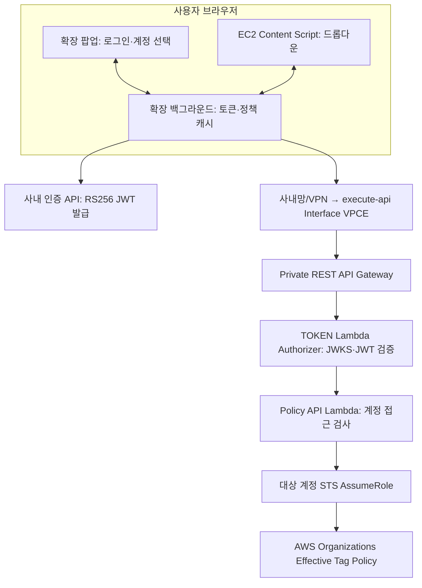
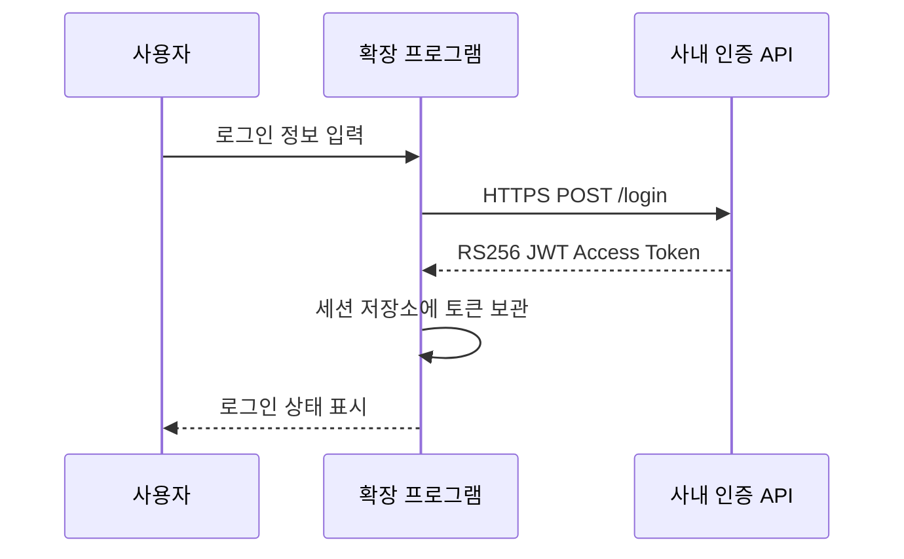
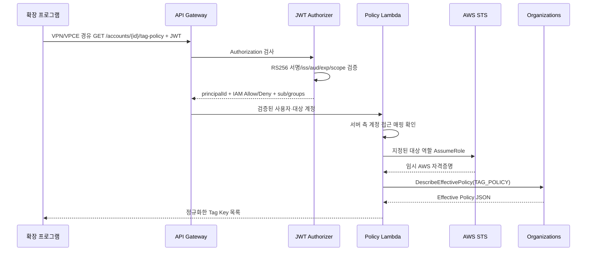
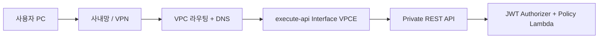

# 시스템 아키텍처

## 1. 컴포넌트 구성

실제 AWS 생성/수정 API 호출은 확장이 아니라 EC2 콘솔에서 이뤄진다.

## 2. 로그인 시퀀스

현재 구현은 자체 로그인 API에 `POST {username,password}` 후 `{access_token}`을 가정한다. 사내 API의 OAuth 리다이렉트/OTP/MFA 흐름은 연결 전 조정해야 한다.

## 3. 정책 조회 시퀀스

## 4. AWS 계정 경계

- 백엔드 계정: API Gateway, Authorizer Lambda, 정책 Lambda.
- 대상 멤버 계정 A/B/C: 각각 `TagPolicyReadRole`을 생성.
- 백엔드 Lambda 실행 역할만 대상 역할을 AssumeRole할 수 있도록 제한.
- 각 대상 역할은 `organizations:DescribeEffectivePolicy` 읽기 권한만 가짐.
- 클라이언트는 AWS 역할 ARN을 전달할 수 없다. 계정→역할 ARN 매핑은 백엔드 서버가 보유.

## 5. 프라이빗 네트워크 경계

- Private REST API는 승인된 `aws:SourceVpce`를 제외한 호출을 명시적으로 거부한다.
- VPCE Security Group은 승인된 사내망/VPN CIDR에서 TCP 443을 허용한다.
- 사내 DNS는 Route 53 Resolver Inbound Endpoint/조건부 전달 또는 검증된 VPCE 전용 DNS 방식을 사용한다.
- 사내 PC/VPN의 라우팅 테이블은 VPC Interface Endpoint의 사설 IP에 도달할 수 있어야 한다.
- VPCE에서 TLS 연결 가능 여부와 REST API/스테이지/리소스 경로 응답을 별도로 검증한다.
- Private REST API는 퍼블릭 API와 달리 VPC Endpoint 경유 연결을 요구한다. DNS와 VPN만 구성하고 VPCE 연결을 누락하면 호출할 수 없다.

## 6. 브라우저별 차이

| 항목 | Chrome | Firefox |
| --- | --- | --- |
| Manifest | MV3 | MV3 |
| 백그라운드 | Service Worker | Background Scripts |
| 공통 기능 코드 | 동일 | 동일 |
| 패키징 | `dist/chrome` | `dist/firefox` |
| 배포 | Chrome Web Store/사내 배포 | Mozilla Add-ons/사내 배포 |

## 7. 장애 및 제한

- 인증 서버·JWKS 불가: 로그인 또는 JWT 검증 실패.
- 권한 부족/역할 부재: 해당 계정 정책 조회 실패.
- AWS 콘솔 DOM 변경: 드롭다운 미표시 가능. 원래 입력은 유지.
- 확장 프로그램은 사용자 선택 계정과 콘솔 계정이 실제로 같은지 자동 입증하지 않음.
- 실제 AWS 리소스 생성 동작 및 API 응답의 E2E 검증은 별도 필요.
- VPN 미연결, DNS 미설정, VPCE SG 차단 시 확장에서 API 요청이 실패한다.
